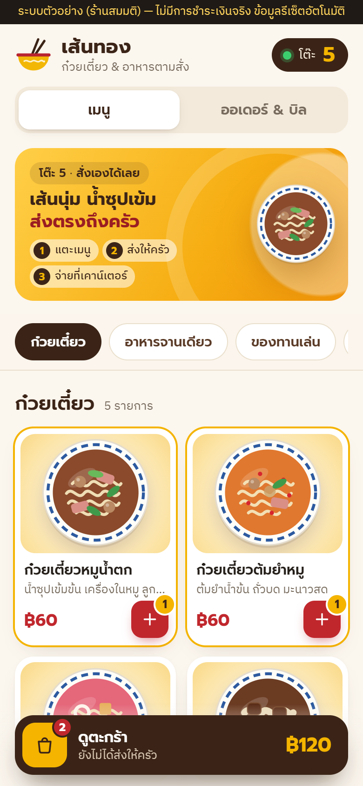
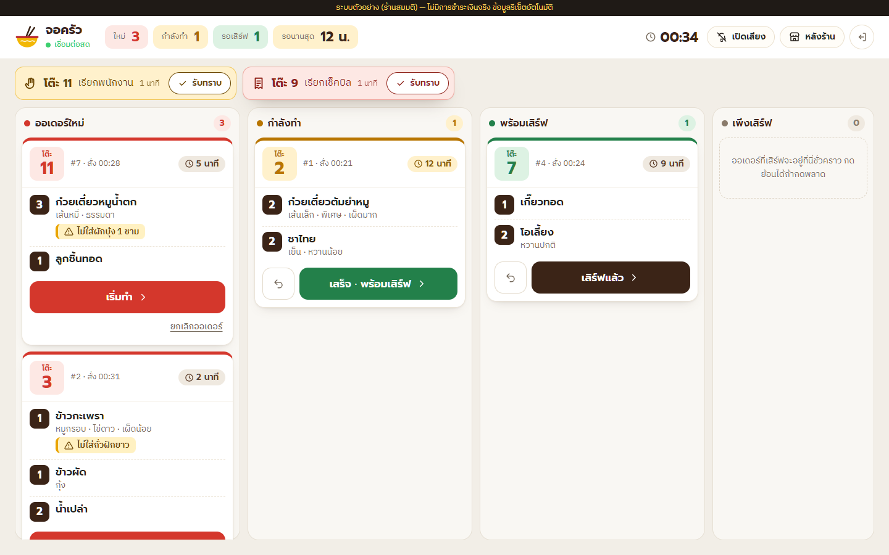
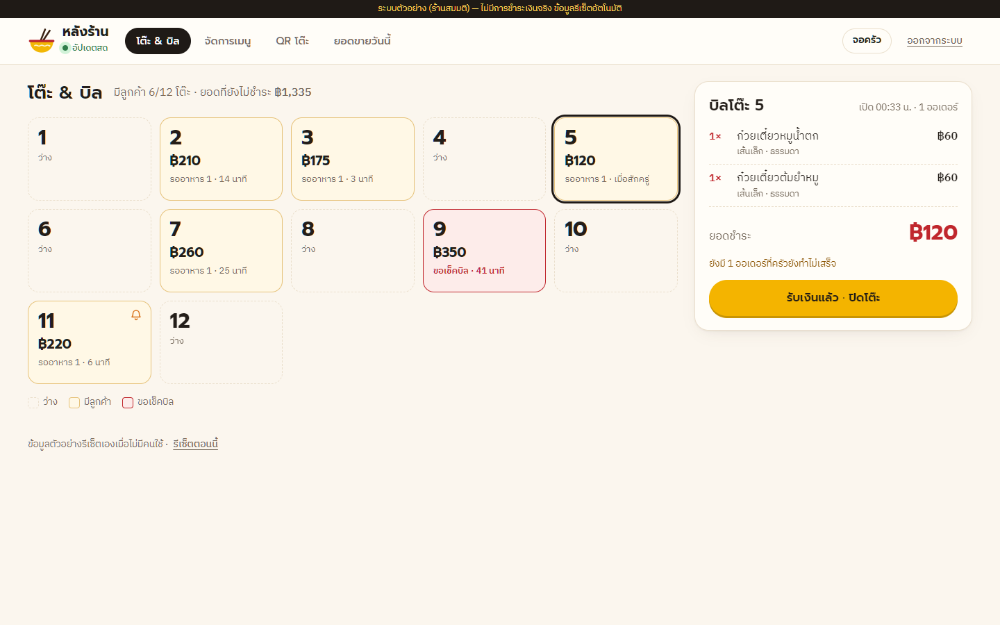

# เส้นทอง — ระบบเมนู QR สั่งอาหารที่โต๊ะ

ลูกค้าสแกน QR ที่โต๊ะแล้วสั่งอาหารเองจากมือถือ ออเดอร์จะ **เด้งเข้าจอครัวแบบเรียลไทม์** ฝั่งครัวกดเลื่อนสถานะ แล้วลูกค้าเห็นบนมือถือทันที ส่วนเจ้าของร้านดูผังโต๊ะ ปิดบิล แก้เมนู และกดของหมดได้เองจากหลังร้าน

> ร้านนี้เป็นธุรกิจสมมติ ทำขึ้นเป็นผลงานตัวอย่าง ระบบนี้ใช้ได้กับร้านก๋วยเตี๋ยว ร้านอาหารตามสั่ง คาเฟ่ ร้านชาบู และร้านเครื่องดื่ม

**ทดลองใช้:** https://senthong.shswsy.workers.dev
- จอครัว: `/kitchen`
- หลังร้าน: `/admin`
- รหัสผ่านพนักงาน: `demo1234`
- ข้อมูลตัวอย่างจะรีเซ็ตเองเมื่อไม่มีคนใช้งาน

**วิธีดูแบบเรียลไทม์:** เปิดจอครัวบนคอมไว้ แล้วสแกน QR ที่หน้าแรกด้วยมือถือ จากนั้นลองสั่งอาหารดู



## ฝั่งลูกค้า (มือถือ ไม่ต้องลงแอป)
- เมนูแบ่งหมวด มีรูปทุกจาน และแสดงราคาชัดเจน
- เลือกตัวเลือกได้ เช่น เส้น ขนาด เนื้อสัตว์ เพิ่มไข่ ความเผ็ด ความหวาน พร้อมช่องหมายเหตุถึงครัว
- ตะกร้ารวมของทั้งโต๊ะ ส่งออเดอร์ได้ในคลิกเดียว และสั่งเพิ่มได้ตลอด
- ติดตามสถานะอาหารแบบสด: รับแล้ว → กำลังทำ → พร้อมเสิร์ฟ → เสิร์ฟแล้ว
- ดูบิลรวมของโต๊ะได้ มีปุ่ม **เรียกพนักงาน** และ **เรียกเช็คบิล**
- เมนูที่ร้านกดว่าหมดจะเทาลงบนมือถือลูกค้าทันที

## จอครัว


- บอร์ดแบ่ง 3 คอลัมน์: ใหม่ / กำลังทำ / พร้อมเสิร์ฟ ออเดอร์ใหม่เด้งขึ้นพร้อมเสียงและไฮไลต์
- แตะครั้งเดียวเพื่อเลื่อนสถานะ และย้อนสถานะได้ถ้ากดพลาด
- การ์ดเปลี่ยนสีเมื่อออเดอร์รอนานเกิน 10 นาที และ 20 นาที
- หมายเหตุ เช่น แพ้อาหาร หรือไม่ใส่ผัก ไฮไลต์เด่นจนมองไม่พลาด
- มีแถบแจ้งเตือนเมื่อโต๊ะไหนเรียกพนักงานหรือเรียกเช็คบิล

## หลังร้าน


- **ผังโต๊ะ:** เห็นสถานะทุกโต๊ะ (ว่าง / มีลูกค้า / ขอเช็คบิล) พร้อมยอดค้างชำระ เปิดดูบิลแล้วกด "รับเงินแล้ว · ปิดโต๊ะ" ได้
- **จัดการเมนู:** เพิ่มหรือแก้ชื่อ ราคา รูป และตัวเลือก มีสวิตช์ "หมด" ที่ลูกค้าเห็นผลทันที
- **QR โต๊ะ:** หน้าพร้อมพิมพ์ QR ทุกโต๊ะ แต่ละโต๊ะมีรหัสลับของตัวเอง จึงสั่งในนามโต๊ะอื่นไม่ได้
- **ยอดขายวันนี้:** ยอดขาย จำนวนบิล ค่าเฉลี่ยต่อบิล เมนูขายดี และยอดรายชั่วโมง

## เทคนิค
| ส่วน | ใช้ |
|---|---|
| หน้าเว็บ | React 19 + TypeScript + Vite |
| API | Hono บน Cloudflare Workers |
| ฐานข้อมูล | Cloudflare D1 (SQLite) |
| Realtime | Durable Object + WebSocket (Hibernation API ทำให้ connection ที่ไม่มีการใช้งานแทบไม่มีค่าใช้จ่าย) |
| Hosting | Cloudflare (ระดับฟรีรองรับร้านขนาดเล็กถึงกลางได้สบาย) |

จุดที่ออกแบบให้ใช้งานจริงได้:
- **ราคาคำนวณที่ server เสมอ** ใช้กติกาชุดเดียวกับหน้าเว็บ (`shared/menu.ts`) ลูกค้าจึงแก้ราคาหรือใส่ตัวเลือกที่ไม่มีอยู่จริงไม่ได้ และมี unit test ครอบคลุม
- **บิลเก็บชื่อและราคา ณ เวลาที่สั่ง** แก้เมนูหรือลบเมนูทีหลังได้โดยบิลเก่าไม่เปลี่ยน
- **กันกดซ้ำ:** ถ้าเปิดจอครัวสองเครื่องแล้วกดพร้อมกัน สถานะเลื่อนแค่ครั้งเดียว และปิดบิลซ้ำหรือปิดผิดรอบลูกค้าไม่ได้
- **ข้อความ realtime เป็นแค่สัญญาณบอกว่า "มีอะไรเปลี่ยน"** แล้วหน้าจอค่อยโหลดข้อมูลจริงจาก server ถ้าเน็ตหลุด ระบบต่อใหม่ให้เองและ sync ทันที
- มี rate limit การสั่งและการเรียกพนักงาน ล็อกอินพนักงานใช้ cookie แบบ HttpOnly และไม่เก็บข้อมูลส่วนตัวของลูกค้า

## รันในเครื่อง
```bash
npm install
cp .dev.vars.example .dev.vars
npm run db:migrate
npm run dev        # http://localhost:5173
npm test
```

## Deploy
```bash
npx wrangler d1 create senthong          # นำ database_id ไปใส่ใน wrangler.jsonc
npm run db:migrate:remote
npx wrangler secret put ADMIN_PASSWORD
npx wrangler secret put SESSION_SECRET
npm run deploy
```
ถ้าจะใช้งานจริง ให้ตั้ง `DEMO` เป็น `"0"` ใน `wrangler.jsonc` เพื่อปิดการรีเซ็ตข้อมูลตัวอย่าง
